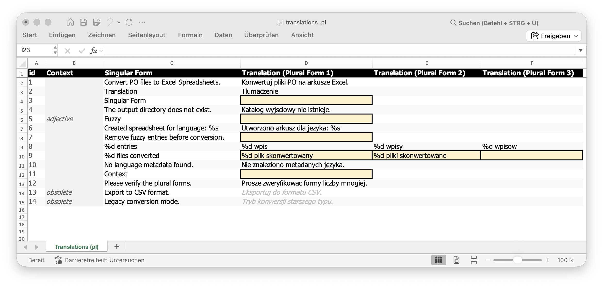

# pox-convert

[](https://pypi.org/project/pox-convert/)
[](https://pypi.org/project/pox-convert/)
[](https://github.com/bartTC/pox/blob/main/LICENSE)
[](https://github.com/bartTC/pox/actions/workflows/tests.yml)
[](https://github.com/bartTC/pox/actions/workflows/tests.yml)

Convert `.po` (gettext) files to Excel spreadsheets and back. Supports fuzzy entries and multiple plural forms.



## Usage

### PO to Excel

```bash
uvx pox-convert export path/to/messages.po
```

Use globbing to convert multiple files at once. Quote the pattern so
pox-convert expands it, including `**` for any depth:

```bash
uvx pox-convert export 'locales/**/django.po'
```

Each file gets its own spreadsheet, named by its language. Paths that match
nothing are reported, and if two files would write the same spreadsheet, the
first one wins and the others are skipped with a warning.

Options:

```
-o, --outdir      Output directory (default: current directory)
-f, --filename    Filename template using {lang} and {date} variables
                  (default: translations_{lang}.xlsx)
-l, --language    Override the language metadata from the PO file
--fuzzy           How to handle fuzzy entries: stop, ignore, include (default: stop)
```

### Excel to PO

```bash
uvx pox-convert import path/to/translations.xlsx
```

Options:

```
-o, --outdir      Output directory (default: current directory)
-f, --filename    Filename template using {lang} variable (default: {lang}.po)
```

## Spreadsheet format

The generated Excel file looks like this (shown for a language with two
plural forms):

| id | Context   | Source Language        | Translation (one) | Translation (other) |
|----|-----------|------------------------|-------------------|---------------------|
| 1  |           | Hello                  | Hallo             | *(n/a)*             |
| 2  | adjective | Open                   | Offen             | *(n/a)*             |
| 3  |           | %d item<br>%d items    | %d Gegenstand     | %d Gegenstände      |
| 4  |           | Goodbye                |                   | *(n/a)*             |
| 5  | obsolete  | Old                    | Alt               | *(n/a)*             |

- Translators only fill in the Translation columns. Empty translations are
  highlighted in yellow with a black border.
- Plural entries show the singular and plural source text on two lines and
  get one column per plural form of the language.
- Plural columns that don't apply to a singular message are hatched gray.
- Obsolete entries show "obsolete" in the Context column.
- Translation cells are formatted as Text, so Excel keeps what translators
  type as typed instead of turning `1/2` into a date or `=...` into a
  formula.
- The header row is frozen, and alternating row stripes improve readability.

### What the import restores

The spreadsheet carries everything needed to rebuild the `.po` file in hidden
columns and a hidden "PO Header" sheet. Leave them in place:

- The exact source strings of plural entries
- The real context and obsolete status of every entry
- Translator comments, developer comments, `#:` references and `#,` flags
- All PO header fields, such as `Plural-Forms` and `Project-Id-Version`

The `fuzzy` flag is not restored: an imported translation counts as reviewed.
Spreadsheets made with pox-convert 1.1.0 or older still import, but without
these details.

## Django integration

pox-convert ships with a Django management command that wraps
`makemessages` to skip fuzzy matching:

```bash
python manage.py makemessages_nofuzzy -l de
```

Add `pox.contrib.django.pox` to your `INSTALLED_APPS` to use it.

